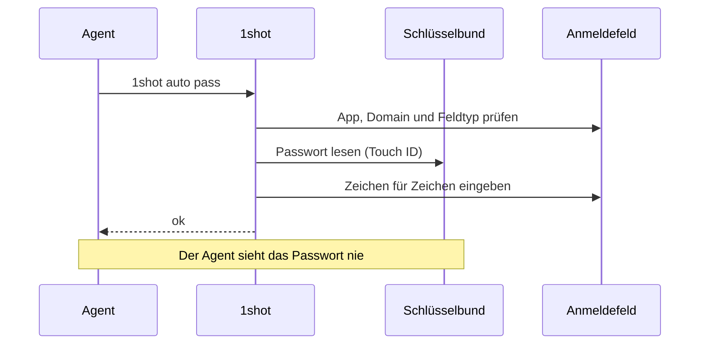
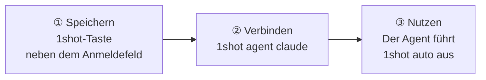
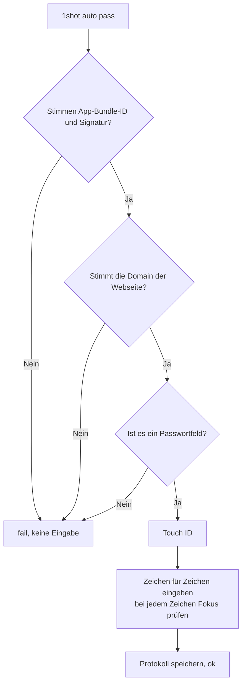
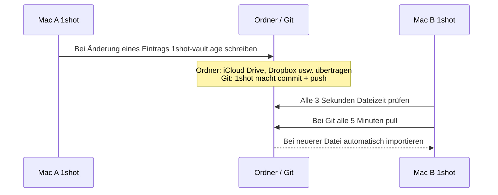

# 1shot

[English](README.md) · [한국어](README.ko.md) · [Español](README.es.md) · [Français](README.fr.md) · [Deutsch](README.de.md) · [Русский](README.ru.md) · [日本語](README.ja.md)


> Lets an LLM agent log in on macOS without seeing the password.

## Installation

```bash
brew install --cask itdar/tap/1shot
1shot doctor
```

- Voraussetzungen: Apple Silicon, macOS 14 oder neuer
- Direkter Download: Lade die `.dmg` von [Releases](https://github.com/itdar/1shot-dist/releases/latest) herunter. Klicke in der App auf **Terminal-Befehl installieren**.
- Berechtigung: Aktiviere unter Systemeinstellungen > Datenschutz & Sicherheit > Bedienungshilfen das Terminal (oder die Agent-App) und 1shot.


1shot gibt gespeicherte Benutzernamen und Passwörter in Anmeldefelder ein.
Der Agent führt nur einen Befehl aus. Der Agent erhält nur `ok` oder `fail: <Grund>` als Ergebnis.

**Unterstützte Umgebung: Mac mit Apple Silicon (M1 oder neuer), macOS 14 oder neuer.** Intel-Macs, iPhone, iPad und Windows werden nicht unterstützt.

**Sprachen:** Englisch (Standard), Koreanisch, Spanisch, Französisch, Deutsch, Russisch, Japanisch. 1shot folgt der Systemsprache.



## Was 1shot macht

| Funktion | Beschreibung |
|---|---|
| 🔑 Anmeldung eingeben | Gibt Benutzername, Passwort und Zwei-Faktor-Code (TOTP) ein |
| 🛡️ Prüfung vor der Eingabe | Gibt nur ein, wenn App-Signatur, Domain der Webseite und Feldtyp stimmen |
| ✋ Prüfung während der Eingabe | Stoppt sofort, wenn der Fokus auf ein anderes Feld wechselt |
| 📝 Eingabeprotokoll | Speichert, wann, wo und wer eingegeben hat. Erkennt Manipulation |
| 📇 Persönliche Daten | Speichert Kontakte, Online-Profile, Arbeit, Lebenslauf, Finanzen, länderspezifische Einträge (z. B. koreanische Wohnungsbewerbung) und eigene Einträge und gibt sie in Formulare ein |
| 🔄 Synchronisierung | Gleicht Macs über den iCloud-Schlüsselbund oder eine verschlüsselte Datei ab |

Passwörter liegen im macOS-Schlüsselbund. 1shot nutzt weder die Zwischenablage noch Befehlszeilenargumente.

## Start in 3 Schritten



**① Speichern.** Klicke im Browser auf ein Anmeldefeld. Neben dem Feld erscheint die Taste **In 1shot speichern**. Klicke auf die Taste und gib Benutzername und Passwort ein.
Andere Wege: Tastenkürzel ⇧⌘1, `1shot new` im Terminal, CSV-Import aus einer anderen App.

Wenn du das Passwort auf der Webseite geändert hast, drücke im Anmeldefeld ⇧⌘2 (Passwort ändern) und gib das neue Passwort ein. 1shot liest keine Werte auf der Seite. Darum erkennt 1shot ein geändertes Passwort nicht selbst.

**② Verbinden.** Installiere den Skill und die Berechtigungsregeln für Claude Code.

```bash
1shot agent claude
```

**③ Nutzen.** Der Agent klickt auf ein Feld und führt einen der folgenden Befehle aus.

```bash
1shot auto         # Benutzername und Passwort zusammen (Start in jedem Feld möglich)
1shot auto user    # nur Benutzername
1shot auto pass    # nur Passwort
1shot auto otp     # Bestätigungscode
```

Wenn im Feld schon Text steht, löscht 1shot den Text und gibt neu ein. Wenn eine Webseite mehrere Konten hat, zeige die Liste mit `1shot matches` an und wähle mit `1shot fill <id> login`. Die Taste neben dem Feld und das Tastenkürzel in der App zeigen ein Menü mit der Kontoliste.

## Was der Agent tun darf

| Agent erlaubt | Nur Mensch (Touch ID oder Mac-Passwort) |
|---|---|
| `auto`, `fill`: eingeben | `add`, `new`, `rm`: Einträge speichern und löschen |
| `check`: nur prüfen | `import`, `import-logins`: importieren |
| `list`: Eintragsnamen anzeigen | `sync`, `store`: Synchronisierung und Speicherort |
| `info list`, `info auto`, `info fill`, `info get`: persönliche Daten eingeben und lesen (nur freigegebene Einträge) | `info set`, `info rm`: persönliche Daten speichern |

Ein Agent kann Touch ID nicht bestehen. Darum kann ein Agent keine Einstellungen ändern und kein Passwort nach außen senden.

## Prüfung vor der Eingabe



Webseiten sind nur erlaubt, wenn sie https nutzen und in einem bekannten Browser laufen (Safari, Chrome, Edge, Firefox, Brave, Arc).

## Synchronisierung zwischen Geräten

Die Daten liegen nur im Schlüsselbund des Macs jedes Benutzers. 1shot hat keinen Server. Um die Daten auf einem anderen Mac zu nutzen, wähle eine der beiden Methoden.

| Methode | Ziel | Funktion |
|---|---|---|
| **iCloud-Schlüsselbund (empfohlen)** | Macs mit derselben Apple-ID | Apple überträgt die Daten automatisch (Ende-zu-Ende-verschlüsselt). Aktiviere die Funktion auf jedem Mac einmal unter Einstellungen > Speicherort. |
| Verschlüsselte Archivdatei (`1shot sync`) | Wenn du iCloud nicht nutzt oder Macs mit anderer Apple-ID hast | Eine verschlüsselte Datei liegt in einem Ordner oder Git-Repository. Ein Ordner-Sync-Tool oder Git überträgt die Datei. |

Die verschlüsselte Archivdatei ist keine Echtzeit-Synchronisierung.



- 1shot verschlüsselt die Datei mit dem Synchronisierungspasswort (age, scrypt). Im Ordner und auf dem Git-Server liegt nur die verschlüsselte Datei.
- Der Import läuft nur, wenn die 1shot-App läuft.
- Wenn ein anderer Mac die Datei später geändert hat, stoppt das automatische Senden. 1shot importiert zuerst und sendet danach.

Details zu den Befehlen: Abschnitt "Synchronisierung zwischen Geräten" in der [Bedienungsanleitung](docs/USAGE.md).

## Grenzen

- 1shot kann Schadprogramme im selben Benutzerkonto nicht vollständig blockieren. 1shot schützt vor Unfällen.
- Einige Apps geben keine Feldinformationen weiter. Für solche Apps schaltest du die Feldtyp-Prüfung aus.
- Windows wird noch nicht unterstützt.

## Dokumente

| Dokument | Inhalt |
|---|---|
| [Bedienungsanleitung](docs/USAGE.md) | Alle Befehle, Eintragsoptionen, persönliche Daten, Synchronisierung, Import |
| [SECURITY.md](SECURITY.md) | Bedrohungsmodell, Restrisiken, Sicherheitsmeldung |
| [Testergebnisse](docs/TESTING.md) | Testergebnisse je Browser und App |
| [Änderungsprotokoll](https://github.com/itdar/1shot-dist/releases) | Änderungen je Version (GitHub Releases) |
| [Datenschutzerklärung](PRIVACY.md) · [Nutzungsbedingungen](TERMS.md) · [Lizenzliste](THIRD_PARTY_LICENSES.md) | |

## License

Proprietäre Software. Alle Rechte vorbehalten. Kopien der Versionen 0.8.5 und älter, die unter der MIT-Lizenz veröffentlicht wurden, behalten diese Lizenz. Siehe [LICENSE](LICENSE).
