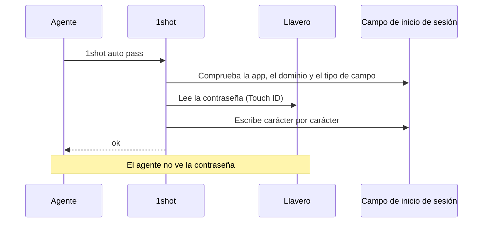
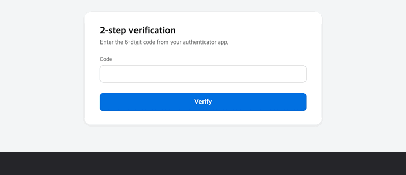
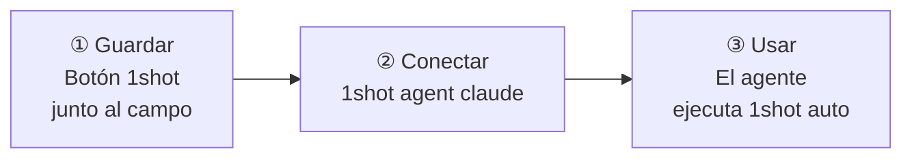
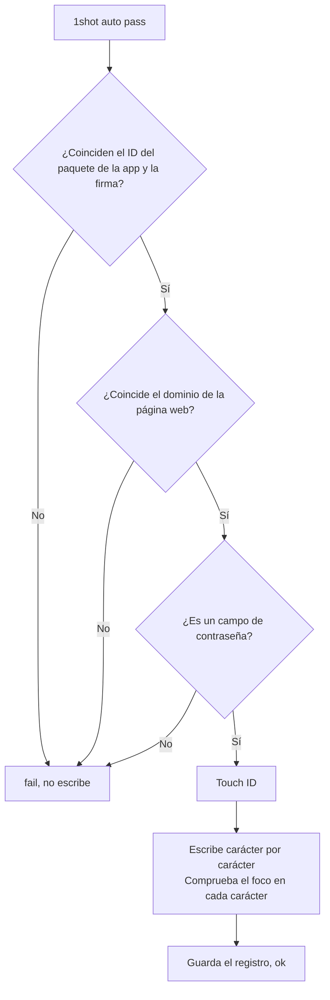
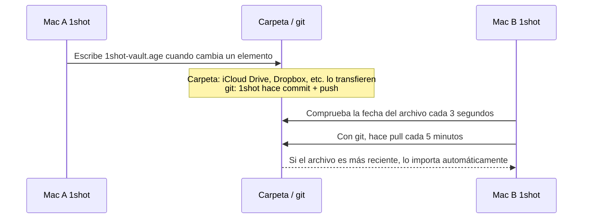

# 1shot

[English](README.md) · [한국어](README.ko.md) · [Español](README.es.md) · [Français](README.fr.md) · [Deutsch](README.de.md) · [Русский](README.ru.md) · [日本語](README.ja.md)


> Lets an LLM agent log in on macOS without seeing the password.

## Instalación

```bash
brew install --cask itdar/tap/1shot
```

- Requisitos: Apple Silicon, macOS 14 o posterior
- Descarga directa: descarga el archivo `.dmg` desde [Releases](https://github.com/itdar/1shot-dist/releases/latest). En la app, pulsa **Instalar comando de terminal**.
- Permisos: en Ajustes del Sistema > Privacidad y seguridad > Accesibilidad, activa la terminal (o la app del agente) y 1shot. Si no funciona, ejecuta `1shot doctor` para ver el estado de los permisos.


1shot escribe el usuario y la contraseña guardados en el campo de inicio de sesión.
El agente solo ejecuta comandos. El agente recibe únicamente `ok` o `fail: <motivo>`.

**Entorno compatible: Mac con Apple Silicon (M1 o posterior), macOS 14 o posterior.** No son compatibles los Mac con Intel, iPhone, iPad ni Windows.

**Idiomas:** inglés (predeterminado), coreano, español, francés, alemán, ruso, japonés. 1shot usa el idioma del sistema.



## Demostración

| Inicio de sesión (usuario y contraseña) | Código de dos pasos |
|---|---|
|  |  |

Formulario de datos personales (`1shot info auto` en cada campo)


## Qué hace

| Función | Descripción |
|---|---|
| 🔑 Escritura de inicio de sesión | Escribe el usuario, la contraseña y el código de verificación en dos pasos (TOTP) |
| 🛡️ Comprobación previa | Escribe solo si coinciden la firma de la app, el dominio de la página web y el tipo de campo |
| ✋ Comprobación durante la escritura | Se detiene de inmediato si el foco pasa a otro campo |
| 📝 Registro de escritura | Guarda cuándo, dónde y quién escribió. Detecta las alteraciones |
| 📇 Datos personales | Guarda y escribe en formularios contactos, perfiles en línea, trabajo, currículo, finanzas, datos por país (por ejemplo, la solicitud de vivienda en Corea) y campos propios |
| 🔄 Sincronización | Sincroniza los Mac con el Llavero de iCloud o con un archivo cifrado |

1shot guarda las contraseñas en el Llavero de macOS. No usa el portapapeles ni argumentos de línea de comandos.

## Empieza en 3 pasos



**① Guardar.** Haz clic en un campo de inicio de sesión en el navegador. Junto al campo aparece el botón **Guardar en 1shot**. Pulsa el botón y escribe el usuario y la contraseña.
Otras opciones: el atajo ⇧⌘1, `1shot new` en la terminal, o la importación de CSV desde otra app.

Si cambias la contraseña en el sitio, pulsa ⇧⌘2 (cambiar contraseña) en el campo de inicio de sesión y escribe la nueva contraseña. 1shot no lee los valores escritos en la página. Por eso no detecta por sí solo que la contraseña cambió.

**② Conectar.** Instala en Claude Code el skill y las reglas de permisos.

```bash
1shot agent claude
```

**③ Usar.** El agente hace clic en el campo y ejecuta estos comandos.

```bash
1shot auto         # usuario y contraseña a la vez (se puede empezar en cualquier campo)
1shot auto user    # solo el usuario
1shot auto pass    # solo la contraseña
1shot auto otp     # código de verificación
```

Si el campo ya tiene texto, 1shot lo borra y escribe de nuevo. Si un sitio tiene varias cuentas, consulta la lista con `1shot matches` y elige con `1shot fill <id> login`. El botón junto al campo y el atajo de la app muestran un menú con la lista de usuarios.

## Qué puede hacer el agente

| El agente puede | Solo una persona puede (Touch ID o contraseña del Mac) |
|---|---|
| `auto`, `fill`: escribir | `add`, `new`, `rm`: guardar y eliminar elementos |
| `check`: solo comprobar | `import`, `import-logins`: importar |
| `list`: ver los nombres de los elementos | `sync`, `store`: sincronización y ubicación de almacenamiento |
| `info list`, `info auto`, `info fill`, `info get`: escribir y leer datos personales (solo los elementos permitidos) | `info set`, `info rm`: guardar datos personales |

El agente no puede superar Touch ID. Por eso el agente no puede cambiar los ajustes ni enviar la contraseña al exterior.

## Comprobación previa



Las páginas web solo se permiten en navegadores conocidos (Safari, Chrome, Edge, Firefox, Brave, Arc) y solo con https.

## Sincronización entre dispositivos

Los datos solo están en el Llavero del Mac de cada usuario. 1shot no tiene servidor. Para usarlos en otro Mac, elige uno de estos dos métodos.

| Método | Destino | Funcionamiento |
|---|---|---|
| **Llavero de iCloud (recomendado)** | Mac con el mismo ID de Apple | Apple lo transfiere automáticamente (cifrado de extremo a extremo). En cada Mac, actívalo una vez en Ajustes > Ubicación de almacenamiento. |
| Archivo de almacén cifrado (`1shot sync`) | Si no usas iCloud, o Mac con otro ID de Apple | Coloca un único archivo cifrado en una carpeta o en un repositorio git. Una herramienta de sincronización de carpetas o git se encarga de transferirlo. |

El archivo de almacén cifrado no es una sincronización en tiempo real.



- 1shot cifra el archivo con la contraseña de sincronización (age, scrypt). La carpeta y el servidor git solo contienen el archivo cifrado.
- La importación solo se hace mientras la app 1shot está en ejecución.
- Si otro Mac cambió el archivo más recientemente, el envío automático se detiene. Primero se importa y después se envía.

Comandos detallados: "Sincronización entre dispositivos" en el [manual de uso](docs/USAGE.md).

## Límites

- 1shot no bloquea por completo un programa malicioso de la misma cuenta de usuario. 1shot es una medida para evitar accidentes.
- Algunas apps no ofrecen información de los campos. En esas apps, usa 1shot con la comprobación del tipo de campo desactivada.
- Todavía no es compatible con Windows.

## Documentos

| Documento | Contenido |
|---|---|
| [Manual de uso](docs/USAGE.md) | Todos los comandos, opciones de elementos, datos personales, sincronización, importación |
| [SECURITY.md](SECURITY.md) | Modelo de amenazas, riesgos restantes, informe de seguridad |
| [Resultados de pruebas](docs/TESTING.md) | Resultados de pruebas por navegador y por app |
| [Registro de cambios](https://github.com/itdar/1shot-dist/releases) | Cambios por versión (GitHub Releases) |
| [Política de privacidad](PRIVACY.md) · [Términos de uso](TERMS.md) · [Lista de licencias](THIRD_PARTY_LICENSES.md) | |

## License

Software propietario. Todos los derechos reservados. Las copias de la versión 0.8.5 y anteriores publicadas bajo la licencia MIT conservan esa licencia. Consulta [LICENSE](LICENSE).
