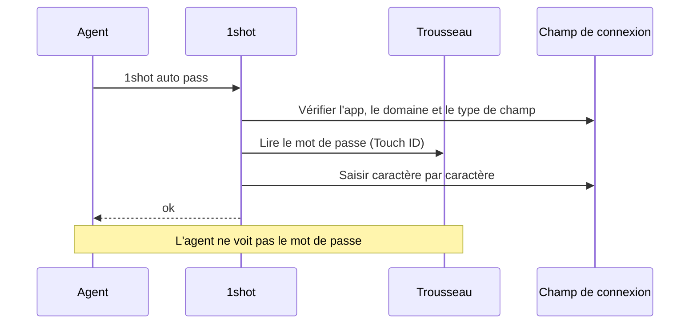
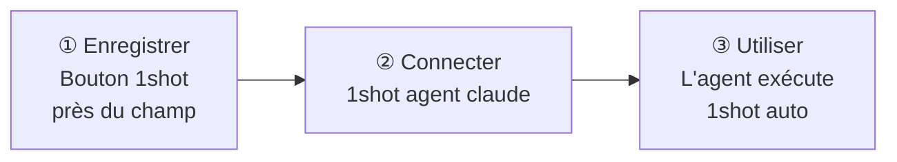
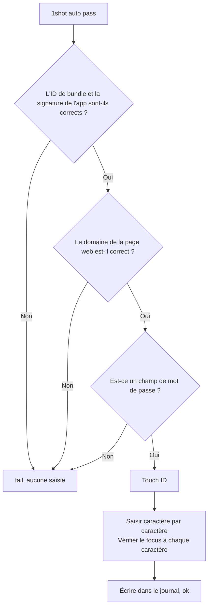
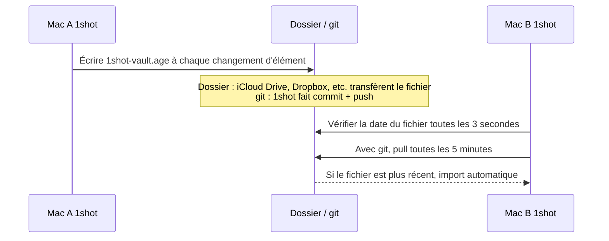

# 1shot

[English](README.md) · [한국어](README.ko.md) · [Español](README.es.md) · [Français](README.fr.md) · [Deutsch](README.de.md) · [Русский](README.ru.md) · [日本語](README.ja.md)


> Permet à un agent LLM de se connecter sur macOS sans voir le mot de passe.

## Installation

```bash
brew install --cask itdar/tap/1shot
```

- Prérequis : Apple Silicon, macOS 14 ou ultérieur
- Téléchargement direct : téléchargez le fichier `.dmg` depuis [Releases](https://github.com/itdar/1shot-dist/releases/latest). Dans l'app, cliquez sur **Installer la commande Terminal**.
- Autorisation : dans Réglages Système > Confidentialité et sécurité > Accessibilité, activez le Terminal (ou l'app de l'agent), 1shot et 1shot-cli. Si cela ne fonctionne pas, lancez `1shot doctor` pour voir l'état des autorisations.

## Démo

Connexion (identifiant et mot de passe)


Formulaire d'informations personnelles (`1shot info auto` dans chaque champ)


1shot saisit l'identifiant et le mot de passe enregistrés dans les champs de connexion.
L'agent exécute seulement une commande. L'agent reçoit uniquement `ok` ou `fail: <raison>`.

**Environnement pris en charge : Mac Apple Silicon (M1 ou ultérieur), macOS 14 ou ultérieur.** Les Mac Intel, iPhone, iPad et Windows ne sont pas pris en charge.

**Langues :** anglais (par défaut), coréen, espagnol, français, allemand, russe, japonais. 1shot suit la langue du système.



## Fonctions

| Fonction | Description |
|---|---|
| 🔑 Saisie de connexion | Saisit l'identifiant, le mot de passe et le code d'authentification à deux facteurs (TOTP) |
| 🛡️ Vérification avant saisie | Saisit uniquement si la signature de l'app, le domaine de la page web et le type de champ sont corrects |
| ✋ Vérification pendant la saisie | S'arrête immédiatement si le focus passe à un autre champ |
| 📝 Journal de saisie | Enregistre quand, où et par qui la saisie a été faite. Détecte toute modification du journal |
| 📇 Informations personnelles | Enregistre et saisit dans les formulaires : contacts, profils en ligne, travail, parcours, finances, éléments propres à un pays (par exemple, le logement coréen « Cheongyak ») et éléments personnalisés |
| 🔄 Synchronisation | Synchronise les Mac via le Trousseau iCloud ou un fichier chiffré |

Le mot de passe est stocké dans le Trousseau macOS. 1shot n'utilise ni le presse-papiers ni les arguments de ligne de commande.

## Démarrer en 3 étapes



**① Enregistrer.** Dans le navigateur, cliquez sur un champ de connexion. Un bouton apparaît près du champ : **⇧⌘1 Enregistrer** sur un nouveau site, **⇧⌘1 Saisir │ ⇧⌘2 Modifier** sur un site enregistré. Cliquez sur **Enregistrer**, puis saisissez l'identifiant et le mot de passe.
Autres méthodes : le raccourci ⇧⌘1, `1shot new` dans le Terminal, ou l'import CSV depuis une autre app.

Si vous changez le mot de passe sur le site, appuyez sur ⇧⌘2 ou cliquez sur **Modifier** près du champ de connexion, puis saisissez le nouveau mot de passe. Si vous appuyez de nouveau sur ⇧⌘1 dans le même formulaire en moins de 90 secondes, 1shot demande si la connexion a échoué et propose de changer le mot de passe. 1shot ne lit pas les valeurs saisies dans la page. Il ne détecte donc pas seul le changement de mot de passe.

**② Connecter.** Installez le skill et les règles d'autorisation dans Claude Code.

```bash
1shot agent claude
```

**③ Utiliser.** L'agent clique sur un champ et exécute les commandes ci-dessous.

```bash
1shot auto         # identifiant et mot de passe en une fois (démarrage possible depuis n'importe quel champ)
1shot auto user    # identifiant seulement
1shot auto pass    # mot de passe seulement
1shot auto otp     # code d'authentification
```

Si le champ contient déjà du texte, 1shot l'efface et saisit la nouvelle valeur. Si un site a plusieurs comptes, affichez la liste avec `1shot matches` et choisissez avec `1shot fill <id> login`. Le bouton près du champ et le raccourci de l'app affichent un menu de la liste des identifiants.

Sur une page de code à 2 étapes, `1shot auto` (et ⇧⌘1) saisit le code si l'élément a un code enregistré et si le champ demande un code.

## Ce que l'agent peut faire

| L'agent peut | Seul un humain peut (Touch ID ou mot de passe du Mac) |
|---|---|
| `auto`, `fill` : saisir | `add`, `new`, `rm` : enregistrer et supprimer des éléments |
| `check` : vérifier seulement | `import`, `import-logins` : importer |
| `list` : voir les noms des éléments | `sync`, `store` : synchronisation et emplacement de stockage |
| `info list`, `info auto`, `info fill`, `info get` : saisir et lire les informations personnelles (éléments autorisés seulement) | `info set`, `info rm` : enregistrer les informations personnelles |

L'agent ne peut pas passer Touch ID. Il ne peut donc pas modifier les réglages ni envoyer le mot de passe à l'extérieur.

## Vérification avant saisie



Pour les pages web, 1shot accepte uniquement les pages https des navigateurs connus (Safari, Chrome, Edge, Firefox, Brave, Arc). Une page sur un port autre que celui par défaut demande le port dans l'élément (par exemple `nas.example.com:5001`).

## Synchronisation entre appareils

Les données restent uniquement dans le Trousseau du Mac de chaque utilisateur. 1shot n'a pas de serveur. Pour utiliser un autre Mac, choisissez l'une des deux méthodes ci-dessous.

| Méthode | Cible | Fonctionnement |
|---|---|---|
| **Trousseau iCloud (recommandé)** | Mac du même compte Apple | Apple transfère les données automatiquement (chiffrement de bout en bout). Sur chaque Mac, activez l'option une fois dans Réglages > Emplacement de stockage. |
| Fichier d'archive chiffré (`1shot sync`) | Sans iCloud, ou Mac d'un autre compte Apple | Placez un fichier chiffré dans un dossier ou un dépôt git. Un outil de synchronisation de dossier ou git transfère le fichier. |

L'archive chiffrée n'est pas une synchronisation en temps réel.



- 1shot chiffre le fichier avec le mot de passe de synchronisation (age, scrypt). Le dossier et le serveur git contiennent uniquement le fichier chiffré.
- L'import se fait seulement si l'app 1shot est en cours d'exécution.
- Si un autre Mac a modifié un fichier plus récemment, l'envoi automatique s'arrête. 1shot importe d'abord, puis envoie.
- Après la configuration, le premier envoi demande Touch ID et montre le dossier. L'envoi automatique commence ensuite.

Commandes détaillées : [Guide d'utilisation](docs/USAGE.md), section « Synchronisation entre appareils ».

## Limites

- 1shot ne bloque pas totalement un programme malveillant du même compte utilisateur. 1shot protège contre les accidents.
- Certaines apps ne fournissent pas d'informations sur les champs. Pour ces apps, désactivez la vérification du type de champ.
- Windows n'est pas encore pris en charge.

## Documentation

| Document | Contenu |
|---|---|
| [Guide d'utilisation](docs/USAGE.md) | Toutes les commandes, options des éléments, informations personnelles, synchronisation, import |
| [SECURITY.md](SECURITY.md) | Modèle de menace, risques restants, signalement de sécurité |
| [Résultats des tests](docs/TESTING.md) | Résultats des tests par navigateur et par app |
| [Historique des changements](https://github.com/itdar/1shot-dist/releases) | Changements par version (GitHub Releases) |
| [Politique de confidentialité](PRIVACY.md) · [Conditions d'utilisation](TERMS.md) · [Liste des licences](THIRD_PARTY_LICENSES.md) | |

## Soutien

1shot est gratuit. Si 1shot vous fait gagner du temps, vous pouvez soutenir le développement sur [GitHub Sponsors](https://github.com/sponsors/itdar).

## License

Logiciel propriétaire. Tous droits réservés. Les copies des versions 0.8.5 et antérieures publiées sous licence MIT conservent cette licence. Voir [LICENSE](LICENSE).
