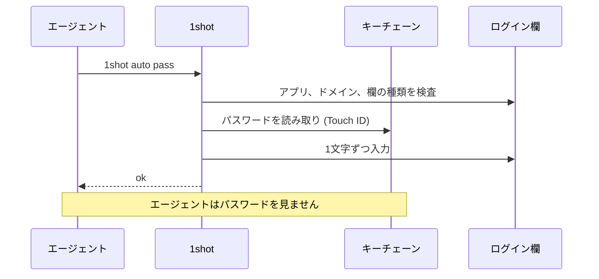
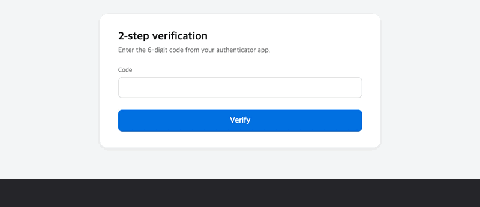
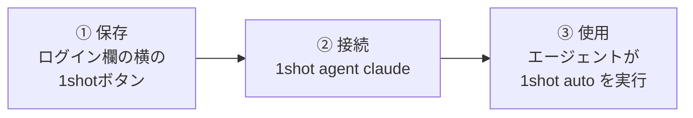
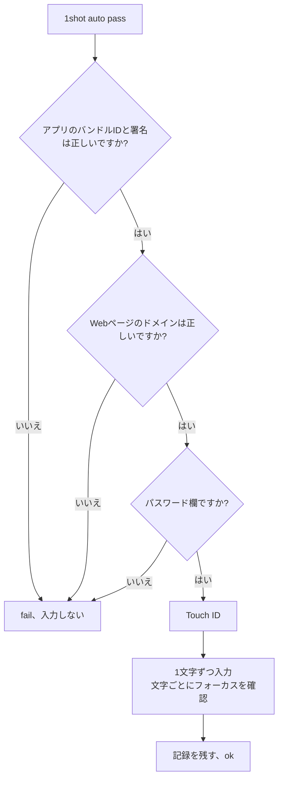
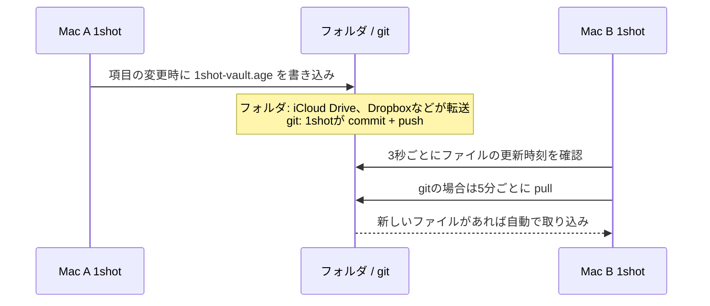

# 1shot

[English](README.md) · [한국어](README.ko.md) · [Español](README.es.md) · [Français](README.fr.md) · [Deutsch](README.de.md) · [Русский](README.ru.md) · [日本語](README.ja.md)


> Lets an LLM agent log in on macOS without seeing the password.

## インストール

```bash
brew install --cask itdar/tap/1shot
```

- 要件: Apple Silicon、macOS 14以降
- 直接ダウンロード: [Releases](https://github.com/itdar/1shot-dist/releases/latest)から `.dmg` をダウンロードします。アプリの**ターミナルコマンドをインストール**をクリックします。
- 権限: システム設定 > プライバシーとセキュリティ > アクセシビリティで、ターミナル(またはエージェントアプリ)と1shotをオンにします。 動かない場合は `1shot doctor` で権限の状態を確認します。


1shotは、保存したIDとパスワードをログイン欄に入力します。
エージェントはコマンドを実行するだけです。エージェントが受け取る結果は `ok` または `fail: <理由>` のみです。

**対応環境: Apple Silicon(M1以降)搭載のMac、macOS 14以降。** Intel Mac、iPhone、iPad、Windowsには対応していません。

**言語:** 英語(既定)、韓国語、スペイン語、フランス語、ドイツ語、ロシア語、日本語。システムの言語に従います。



## デモ

| ログイン (ユーザ名とパスワード) | 2段階認証コード |
|---|---|
|  |  |

個人情報フォーム (欄ごとに `1shot info auto`)


## できること

| 機能 | 説明 |
|---|---|
| 🔑 ログイン入力 | ID、パスワード、2段階認証コード(TOTP)を入力します |
| 🛡️ 入力前の検査 | アプリの署名、Webページのドメイン、欄の種類が正しい場合のみ入力します |
| ✋ 入力中の検査 | フォーカスが別の欄に移ると、すぐに停止します |
| 📝 入力の記録 | いつ、どこに、誰が入力したかを記録します。改ざんを検知します |
| 📇 個人情報 | 連絡先、オンラインプロフィール、勤務先、経歴、金融、国別の項目(韓国の住宅申込など)、独自に作成した項目を保存し、フォームに入力します |
| 🔄 同期 | iCloudキーチェーンまたは暗号化ファイルで、Mac間のデータをそろえます |

パスワードはmacOSのキーチェーンに保存します。クリップボードとコマンドライン引数は使いません。

## 3ステップで開始



**① 保存。** ブラウザでログイン欄をクリックします。欄の横に**1shotに保存**ボタンが表示されます。ボタンをクリックし、IDとパスワードを入力します。
別の方法: ショートカット ⇧⌘1、ターミナルの `1shot new`、他のアプリからのCSVインポート。

サイトでパスワードを変更した場合は、ログイン欄で ⇧⌘2(パスワード変更)を押し、新しいパスワードを入力します。1shotはページに入力された値を読み取りません。そのため、変更後のパスワードを自動では把握できません。

**② 接続。** Claude Codeにskillと権限ルールをインストールします。

```bash
1shot agent claude
```

**③ 使用。** エージェントが欄をクリックし、次のコマンドを実行します。

```bash
1shot auto         # IDとパスワードを一度に (どの欄から始めてもよい)
1shot auto user    # IDのみ
1shot auto pass    # パスワードのみ
1shot auto otp     # 認証コード
```

欄にすでに文字がある場合は、消してから新しく入力します。1つのサイトに複数のアカウントがある場合は、`1shot matches` で一覧を表示し、`1shot fill <id> login` で選びます。アプリの欄横ボタンとショートカットは、IDの一覧メニューを表示します。

## エージェントができること

| エージェントができる操作 | 人だけができる操作 (Touch IDまたはMacのパスワード) |
|---|---|
| `auto`、`fill`: 入力 | `add`、`new`、`rm`: 項目の保存と削除 |
| `check`: 検査のみ | `import`、`import-logins`: インポート |
| `list`: 項目名の表示 | `sync`、`store`: 同期と保存場所 |
| `info list`、`info auto`、`info fill`、`info get`: 個人情報の入力と読み取り(許可した項目のみ) | `info set`、`info rm`: 個人情報の保存 |

エージェントはTouch IDを通過できません。そのため、エージェントは設定を変更したり、パスワードを外部に送信したりできません。

## 入力前の検査



Webページは、既知のブラウザ(Safari、Chrome、Edge、Firefox、Brave、Arc)のhttpsページのみ許可します。

## デバイス間の同期

データは各ユーザーのMacのキーチェーンにのみ存在します。1shotにはサーバがありません。別のMacで使うには、次の2つの方法から1つを選びます。

| 方法 | 対象 | 動作 |
|---|---|---|
| **iCloudキーチェーン (推奨)** | 同じApple Accountを使うMac | Appleが自動で転送します(エンドツーエンド暗号化)。各Macで、設定 > 保存場所から一度オンにします。 |
| 暗号化アーカイブファイル (`1shot sync`) | iCloudを使わない場合、別のApple Accountを使うMac | 暗号化したファイルを1つ、フォルダまたはgitリポジトリに置きます。転送はフォルダ同期ツールまたはgitが行います。 |

暗号化アーカイブファイルは、リアルタイム同期ではありません。



- ファイルは同期パスワードで暗号化します(age、scrypt)。フォルダとgitサーバには、暗号化されたファイルのみが存在します。
- 取り込みは、1shotアプリの実行中のみ行います。
- 別のMacがより新しく変更したファイルがある場合、自動送信は停止します。先に取り込んでから送信します。

詳しいコマンド: [使用ガイド](docs/USAGE.md)の「デバイス間の同期」。

## 制限事項

- 同じユーザーアカウントで動く悪意のあるプログラムは、完全には防げません。1shotは、事故を防ぐための仕組みです。
- 欄の情報を提供しないアプリがあります。そのようなアプリでは、欄の種類の検査をオフにして使います。
- Windowsにはまだ対応していません。

## ドキュメント

| ドキュメント | 内容 |
|---|---|
| [使用ガイド](docs/USAGE.md) | すべてのコマンド、項目のオプション、個人情報、同期、インポート |
| [SECURITY.md](SECURITY.md) | 脅威モデル、残存リスク、セキュリティの報告 |
| [テスト結果](docs/TESTING.md) | ブラウザとアプリごとのテスト結果 |
| [変更履歴](https://github.com/itdar/1shot-dist/releases) | バージョンごとの変更 (GitHub Releases) |
| [プライバシーポリシー](PRIVACY.md) · [利用規約](TERMS.md) · [ライセンス一覧](THIRD_PARTY_LICENSES.md) | |

## License

プロプライエタリ ソフトウェアです。All rights reserved. MITライセンスで公開された0.8.5以前のバージョンのコピーは、そのライセンスに従います。[LICENSE](LICENSE)を参照してください。
