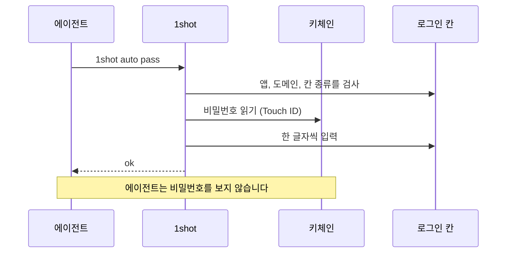
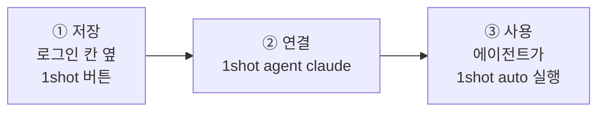
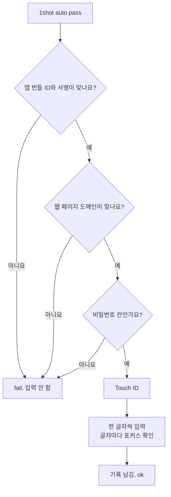
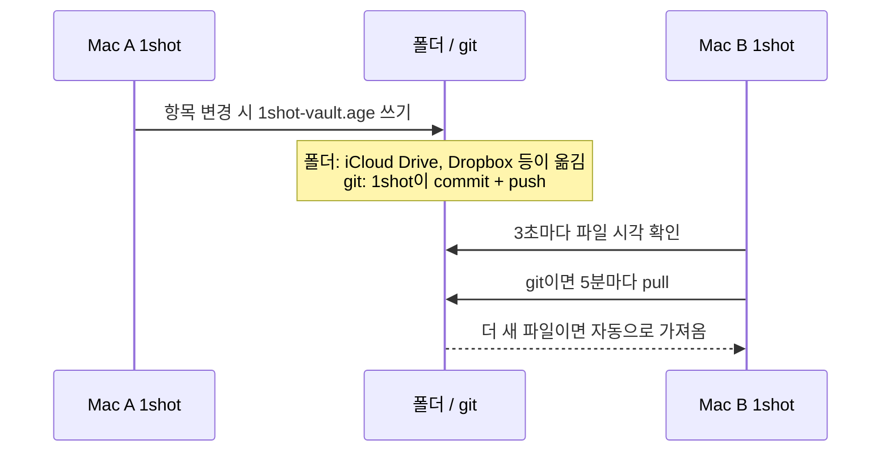

# 1shot

[English](README.md) · [한국어](README.ko.md) · [Español](README.es.md) · [Français](README.fr.md) · [Deutsch](README.de.md) · [Русский](README.ru.md) · [日本語](README.ja.md)


> LLM 에이전트가 비밀번호를 보지 않고 macOS에서 로그인하게 합니다.

## 설치

```bash
brew install --cask itdar/tap/1shot
```

- 요구 사항: Apple Silicon, macOS 14 이상
- 직접 받기: [Releases](https://github.com/itdar/1shot-dist/releases/latest)에서 `.dmg`를 받습니다. 앱의 **터미널 명령 설치**를 누릅니다.
- 권한: 시스템 설정 > 개인정보 보호 및 보안 > 손쉬운 사용에서 터미널(또는 에이전트 앱), 1shot, 1shot-cli를 켭니다. 동작하지 않으면 `1shot doctor`로 권한 상태를 확인합니다.

## 데모

로그인 (아이디와 비밀번호)


개인정보 양식 (칸마다 `1shot info auto`)


1shot은 저장된 아이디와 비밀번호를 로그인 칸에 입력합니다.
에이전트는 명령만 실행합니다. 에이전트가 받는 결과는 `ok` 또는 `fail: <이유>`뿐입니다.

**지원 환경: Apple Silicon(M1 이상) Mac, macOS 14 이상.** Intel Mac, iPhone, iPad, Windows는 지원하지 않습니다.

**언어:** 영어(기본), 한국어, 스페인어, 프랑스어, 독일어, 러시아어, 일본어. 시스템 언어를 따릅니다.



## 무엇을 하나요

| 기능 | 설명 |
|---|---|
| 🔑 로그인 입력 | 아이디, 비밀번호, 2단계 인증 코드(TOTP)를 입력합니다 |
| 🛡️ 입력 전 검사 | 앱 서명, 웹 페이지 도메인, 칸 종류가 맞을 때만 입력합니다 |
| ✋ 입력 중 검사 | 포커스가 다른 칸으로 바뀌면 바로 멈춥니다 |
| 📝 입력 기록 | 언제, 어디에, 누가 입력했는지 남깁니다. 변조를 탐지합니다 |
| 📇 개인정보 | 연락처, 온라인 프로필, 직장, 이력, 금융, 나라별 항목(한국 주택 청약 등), 직접 만든 항목을 저장하고 양식에 입력합니다 |
| 🔄 동기화 | iCloud 키체인 또는 암호화 파일로 맥끼리 맞춥니다 |

비밀번호는 macOS 키체인에 저장합니다. 클립보드와 명령줄 인자는 쓰지 않습니다.

## 3단계로 시작



**① 저장.** 브라우저에서 로그인 칸을 누릅니다. 칸 옆에 버튼이 나옵니다. 처음 보는 사이트는 **⇧⌘1 저장**, 저장된 사이트는 **⇧⌘1 입력 │ ⇧⌘2 수정**입니다. **저장**을 누르고 아이디와 비밀번호를 칩니다.
다른 방법: 단축키 ⇧⌘1, 터미널의 `1shot new`, 다른 앱의 CSV 가져오기.

사이트에서 비밀번호를 바꿨으면 로그인 칸에서 ⇧⌘2를 누르거나 칸 옆의 **수정**을 누르고 새 비밀번호를 넣습니다. 같은 로그인 칸에서 90초 안에 ⇧⌘1을 다시 누르면 1shot이 로그인이 안 됐는지 묻고 비밀번호 바꾸기를 보여 줍니다. 1shot은 페이지에 입력된 값을 읽지 않으므로 바뀐 비밀번호를 스스로 알아내지 않습니다.

**② 연결.** Claude Code에 skill과 권한 규칙을 설치합니다.

```bash
1shot agent claude
```

**③ 사용.** 에이전트가 칸을 누르고 아래 명령을 실행합니다.

```bash
1shot auto         # 아이디와 비밀번호를 한 번에 (어느 칸에서 시작해도 됨)
1shot auto user    # 아이디만
1shot auto pass    # 비밀번호만
1shot auto otp     # 인증 코드
```

칸에 이미 글자가 있으면 지우고 새로 입력합니다. 한 사이트에 계정이 여러 개면 `1shot matches`로 목록을 보고 `1shot fill <id> login`으로 고릅니다. 앱의 칸 옆 버튼과 단축키는 아이디 목록 메뉴를 보여 줍니다.

2단계 인증 화면에서는 항목에 인증 코드가 저장되어 있고 칸이 코드를 묻는 칸이면 `1shot auto`(와 ⇧⌘1)가 코드를 입력합니다.

## 에이전트가 할 수 있는 것

| 에이전트 가능 | 사람만 가능 (Touch ID 또는 맥 암호) |
|---|---|
| `auto`, `fill`: 입력 | `add`, `new`, `rm`: 항목 저장과 삭제 |
| `check`: 검사만 | `import`, `import-logins`: 가져오기 |
| `list`: 항목 이름 보기 | `sync`, `store`: 동기화와 저장 위치 |
| `info list`, `info auto`, `info fill`, `info get`: 개인정보 입력과 읽기(허용한 항목만) | `info set`, `info rm`: 개인정보 저장 |

에이전트는 Touch ID를 통과할 수 없습니다. 그래서 에이전트는 설정을 바꾸거나 비밀번호를 밖으로 보낼 수 없습니다.

## 입력 전 검사



웹 페이지는 알려진 브라우저(Safari, Chrome, Edge, Firefox, Brave, Arc)의 https 페이지만 허용합니다. 기본 포트가 아닌 페이지는 항목에 포트를 적어야 합니다(예: `nas.example.com:5001`).

## 기기 간 동기화

데이터는 각 사용자의 Mac 키체인에만 있습니다. 1shot에는 서버가 없습니다. 다른 Mac에서 쓰려면 아래 두 방법 중 하나를 고릅니다.

| 방법 | 대상 | 동작 |
|---|---|---|
| **iCloud 키체인 (추천)** | 같은 Apple 계정의 Mac | Apple이 자동으로 옮깁니다(종단 간 암호화). Mac마다 설정 > 저장 위치에서 한 번 켭니다. |
| 암호화 보관 파일 (`1shot sync`) | iCloud를 쓰지 않을 때, 다른 Apple 계정의 Mac | 암호화한 파일 하나를 폴더나 git 저장소에 둡니다. 옮기는 일은 폴더 동기화 도구나 git이 합니다. |

암호화 보관 파일은 실시간 동기화가 아닙니다.



- 파일은 동기화 암호로 암호화합니다(age, scrypt). 폴더와 git 서버에는 암호화된 파일만 있습니다.
- 가져오기는 1shot 앱이 실행 중일 때만 합니다.
- 다른 Mac이 더 최근에 바꾼 파일이 있으면 자동 보내기는 멈춥니다. 먼저 가져온 뒤 보냅니다.
- 설정한 뒤 첫 보내기는 Touch ID를 묻고 폴더를 보여 줍니다. 자동 보내기는 그다음부터 합니다.

자세한 명령: [사용 설명서](docs/USAGE.md)의 "기기 간 동기화".

## 한계

- 같은 사용자 계정의 악성 프로그램은 완전히 막지 못합니다. 1shot은 사고를 막는 장치입니다.
- 칸 정보를 주지 않는 앱이 있습니다. 그런 앱은 칸 종류 검사를 끄고 씁니다.
- Windows는 아직 지원하지 않습니다.

## 문서

| 문서 | 내용 |
|---|---|
| [사용 설명서](docs/USAGE.md) | 모든 명령, 항목 옵션, 개인정보, 동기화, 가져오기 |
| [SECURITY.md](SECURITY.md) | 위협 모델, 남은 위험, 보안 신고 |
| [시험 결과](docs/TESTING.md) | 브라우저와 앱별 시험 결과 |
| [변경 기록](https://github.com/itdar/1shot-dist/releases) | 버전별 변경 (GitHub Releases) |
| [개인정보 처리방침](PRIVACY.md) · [이용 약관](TERMS.md) · [라이선스 목록](THIRD_PARTY_LICENSES.md) | |

## 후원

1shot은 무료입니다. 도움이 되었다면 다음 페이지에서 개발을 후원할 수 있습니다: [GitHub Sponsors](https://github.com/sponsors/itdar).

## License

독점 소프트웨어입니다(All rights reserved). 0.8.5 이하 버전 중 MIT 라이선스로 공개된 사본은 그 라이선스를 따릅니다. [LICENSE](LICENSE)를 보세요.
