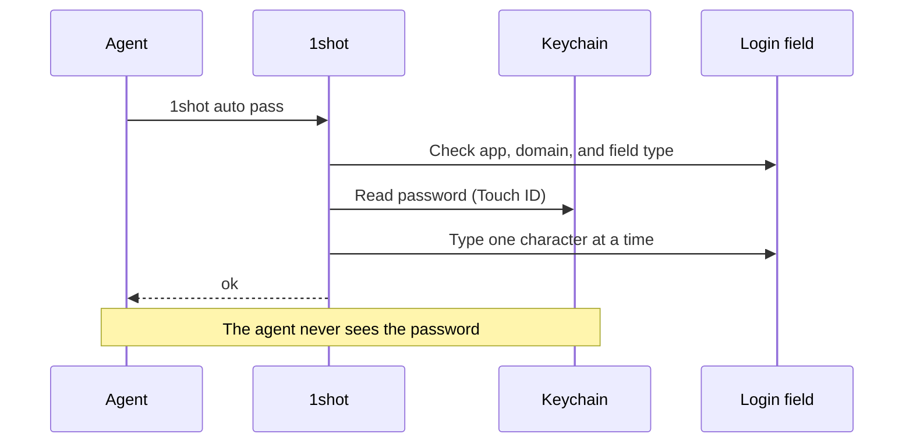
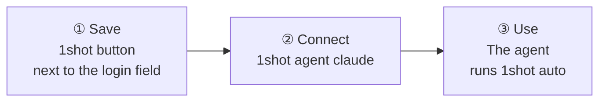
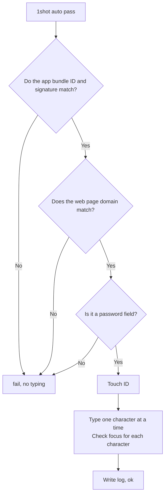
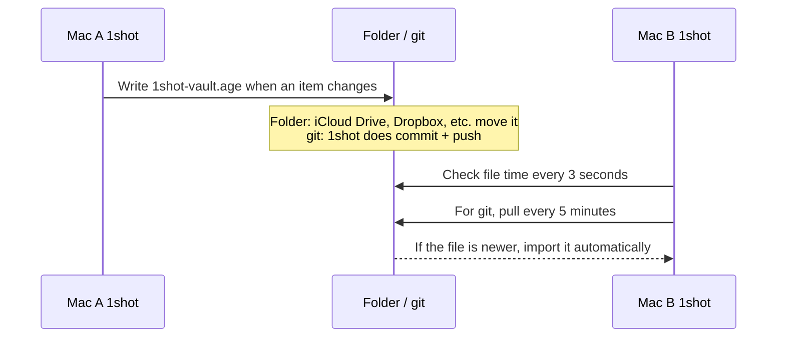

# 1shot

[English](README.md) · [한국어](README.ko.md) · [Español](README.es.md) · [Français](README.fr.md) · [Deutsch](README.de.md) · [Русский](README.ru.md) · [日本語](README.ja.md)


> Lets an LLM agent log in on macOS without seeing the password.

## Install

```bash
brew install --cask itdar/tap/1shot
```

- Requirements: Apple Silicon, macOS 14 or later
- Direct download: Download the `.dmg` from [Releases](https://github.com/itdar/1shot-dist/releases/latest). Click **Install terminal command** in the app.
- Permission: Go to System Settings > Privacy & Security > Accessibility. Turn on Terminal (or your agent app) and 1shot. If it does not work, run `1shot doctor` to see the permission state.

## Demo

Log in (user name and password)


Personal info form (`1shot info auto` in each field)


1shot types a saved ID and password into a login field.
The agent only runs a command. The agent gets only `ok` or `fail: <reason>` as the result.

**Supported: Apple Silicon (M1 or later) Mac, macOS 14 or later.** Intel Mac, iPhone, iPad, and Windows are not supported.

**Languages:** English (default), Korean, Spanish, French, German, Russian, Japanese. 1shot follows the system language.



## What it does

| Feature | Description |
|---|---|
| 🔑 Login input | Types the ID, the password, and the two-step verification code (TOTP) |
| 🛡️ Check before typing | Types only if the app signature, the web page domain, and the field type match |
| ✋ Check while typing | Stops at once if the focus moves to a different field |
| 📝 Input log | Records when, where, and who typed. Detects tampering |
| 📇 Personal info | Saves and fills contacts, online profiles, work, history, finance, country-specific items (for example, Korean housing subscription), and custom items |
| 🔄 Sync | Keeps Macs in step through iCloud Keychain or an encrypted file |

1shot saves passwords in the macOS Keychain. It does not use the clipboard or command-line arguments.

## Start in 3 steps



**① Save.** Click a login field in the browser. A button appears next to the field: **⇧⌘1 Save** on a new site, **⇧⌘1 Type │ ⇧⌘2 Edit** on a saved one. Click **Save** and type the ID and password.
Other ways: the ⇧⌘1 hotkey, `1shot new` in the terminal, or CSV import from another app.

If you changed the password on the site, press ⇧⌘2 or click **Edit** next to the login field, then enter the new password. If you press ⇧⌘1 again on the same login form within 90 seconds, 1shot asks whether the login failed and offers to change the password. 1shot does not read the values typed in the page. It cannot find out the changed password by itself.

**② Connect.** Install the skill and the permission rules in Claude Code.

```bash
1shot agent claude
```

**③ Use.** The agent clicks a field and runs the commands below.

```bash
1shot auto         # ID and password together (you can start from any field)
1shot auto user    # ID only
1shot auto pass    # password only
1shot auto otp     # verification code
```

If the field already has text, 1shot deletes it and types the new text. If a site has more than one account, run `1shot matches` to see the list. Then run `1shot fill <id> login` to choose one. The button next to the field in the app and the hotkey show an ID list menu.

On a two-step code page, `1shot auto` (and ⇧⌘1) types the code when the entry has a stored code and the field asks for a code.

## What the agent can do

| Agent can do | Human only (Touch ID or Mac password) |
|---|---|
| `auto`, `fill`: type | `add`, `new`, `rm`: save and delete items |
| `check`: check only | `import`, `import-logins`: import |
| `list`: view item names | `sync`, `store`: sync and storage location |
| `info list`, `info auto`, `info fill`, `info get`: type and read personal info (allowed items only) | `info set`, `info rm`: save personal info |

The agent cannot pass Touch ID. So the agent cannot change settings or send the password out.

## Check before typing



1shot allows only https pages in known browsers (Safari, Chrome, Edge, Firefox, Brave, Arc).

## Sync between devices

Data stays only in each user's Mac Keychain. 1shot has no server. To use the data on another Mac, choose one of the two methods below.

| Method | For | How it works |
|---|---|---|
| **iCloud Keychain (recommended)** | Macs with the same Apple account | Apple moves the data automatically (end-to-end encrypted). On each Mac, turn it on once in Settings > Storage location. |
| Encrypted vault file (`1shot sync`) | When you do not use iCloud, or Macs with different Apple accounts | Puts one encrypted file in a folder or a git repository. A folder sync tool or git moves the file. |

The encrypted vault file is not real-time sync.



- 1shot encrypts the file with the sync password (age, scrypt). The folder and the git server hold only the encrypted file.
- Import runs only while the 1shot app is running.
- If another Mac changed the file more recently, automatic export stops. 1shot imports first, then exports.

For detailed commands, see "Sync between devices" in the [User guide](docs/USAGE.md).

## Limits

- 1shot cannot fully stop malicious programs that run under the same user account. 1shot is a safeguard against accidents.
- Some apps do not give field information. For those apps, turn off the field type check.
- Windows is not supported yet.

## Documents

| Document | Content |
|---|---|
| [User guide](docs/USAGE.md) | All commands, item options, personal info, sync, import |
| [SECURITY.md](SECURITY.md) | Threat model, remaining risks, security reports |
| [Test results](docs/TESTING.md) | Test results for each browser and app |
| [Changelog](https://github.com/itdar/1shot-dist/releases) | Changes for each version (GitHub Releases) |
| [Privacy policy](PRIVACY.md) · [Terms of use](TERMS.md) · [License list](THIRD_PARTY_LICENSES.md) | |

## License

Proprietary. All rights reserved. Copies of versions 0.8.5 and earlier that were published under the MIT License keep that license. See [LICENSE](LICENSE).
