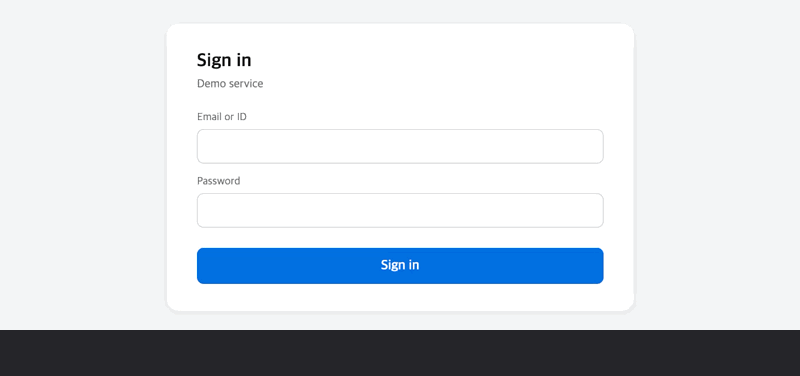
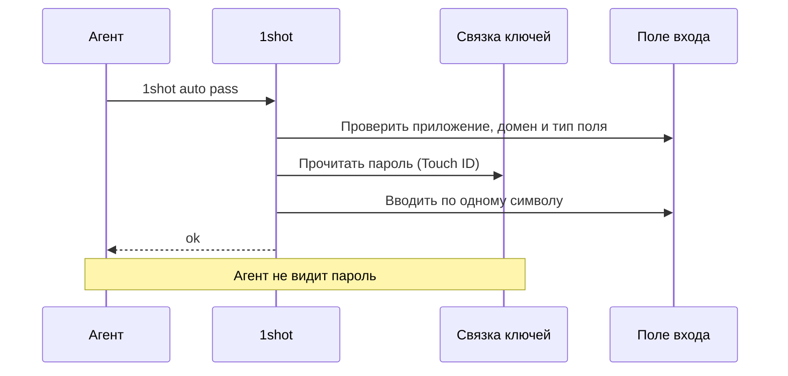
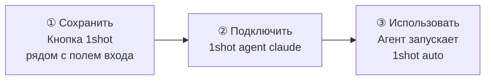
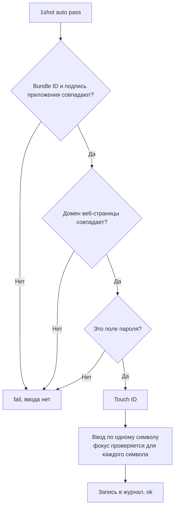
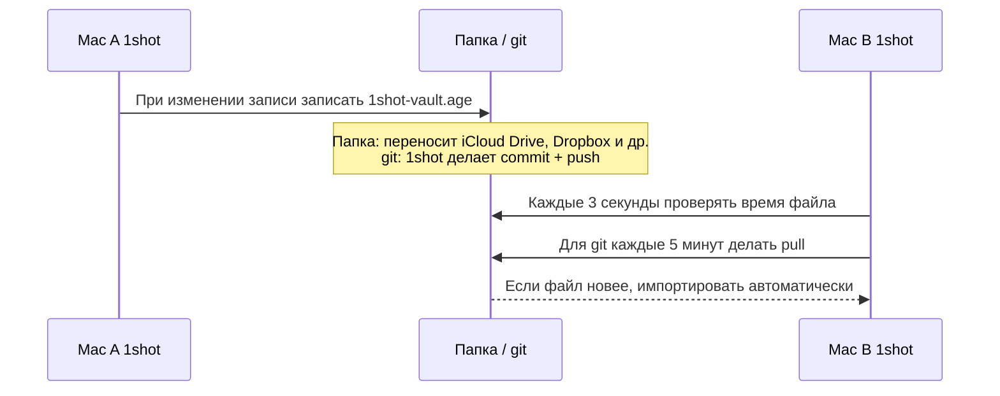

# 1shot

[English](README.md) · [한국어](README.ko.md) · [Español](README.es.md) · [Français](README.fr.md) · [Deutsch](README.de.md) · [Русский](README.ru.md) · [日本語](README.ja.md)


> Позволяет LLM-агенту входить в систему на macOS, не видя пароль.

## Установка

```bash
brew install --cask itdar/tap/1shot
```

- Требования: Apple Silicon, macOS 14 и новее
- Прямая загрузка: скачайте `.dmg` со страницы [Releases](https://github.com/itdar/1shot-dist/releases/latest). В приложении нажмите **Установить команду для терминала**.
- Разрешения: в Системные настройки > Конфиденциальность и безопасность > Универсальный доступ включите терминал (или приложение агента) и 1shot. Если не работает, выполните `1shot doctor`, чтобы увидеть состояние разрешений.

## Демо

Вход (логин и пароль)



Форма с личными данными (`1shot info auto` в каждом поле)


1shot вводит сохранённые логин и пароль в поля входа.
Агент только запускает команды. Агент получает в ответ лишь `ok` или `fail: <причина>`.

**Поддерживаемая среда: Mac с Apple Silicon (M1 и новее), macOS 14 и новее.** Mac с Intel, iPhone, iPad и Windows не поддерживаются.

**Языки:** английский (по умолчанию), корейский, испанский, французский, немецкий, русский, японский. 1shot использует язык системы.



## Что делает 1shot

| Функция | Описание |
|---|---|
| 🔑 Ввод данных для входа | Вводит логин, пароль и код двухфакторной аутентификации (TOTP) |
| 🛡️ Проверка перед вводом | Вводит данные, только если совпадают подпись приложения, домен веб-страницы и тип поля |
| ✋ Проверка во время ввода | Сразу останавливает ввод, если фокус переходит на другое поле |
| 📝 Журнал ввода | Записывает, когда, куда и кто вводил данные. Обнаруживает изменение журнала |
| 📇 Личные данные | Хранит контакты, онлайн-профили, место работы, резюме, финансы, пункты для разных стран (например, корейская подписка на жильё) и ваши собственные пункты, и вводит их в формы |
| 🔄 Синхронизация | Синхронизирует Mac через Связку ключей iCloud или зашифрованный файл |

1shot хранит пароли в Связке ключей macOS. 1shot не использует буфер обмена и аргументы командной строки.

## Начало работы за 3 шага



**① Сохранить.** В браузере нажмите на поле входа. Рядом с полем появится кнопка: **⇧⌘1 Сохранить** на новом сайте, **⇧⌘1 Ввод │ ⇧⌘2 Изменить** на сохранённом. Нажмите **Сохранить** и введите логин и пароль.
Другие способы: сочетание клавиш ⇧⌘1, команда `1shot new` в терминале, импорт CSV из другого приложения.

Если вы сменили пароль на сайте, нажмите ⇧⌘2 в поле входа или кнопку **Изменить** рядом с ним и введите новый пароль. Если в той же форме входа снова нажать ⇧⌘1 в течение 90 секунд, 1shot спросит, не удался ли вход, и предложит сменить пароль. 1shot не читает значения на странице, поэтому сам не узнает о смене пароля.

**② Подключить.** Установите в Claude Code skill и правила разрешений.

```bash
1shot agent claude
```

**③ Использовать.** Агент нажимает на поле и запускает одну из команд ниже.

```bash
1shot auto         # логин и пароль сразу (можно начать с любого поля)
1shot auto user    # только логин
1shot auto pass    # только пароль
1shot auto otp     # код подтверждения
```

Если в поле уже есть текст, 1shot удаляет его и вводит данные заново. Если на сайте несколько учётных записей, посмотрите список командой `1shot matches` и выберите запись командой `1shot fill <id> login`. Кнопка рядом с полем и сочетание клавиш в приложении показывают меню со списком логинов.

На странице кода второго шага `1shot auto` (и ⇧⌘1) вводит код, если у записи есть сохранённый код и поле запрашивает код.

## Что может делать агент

| Агент может | Только человек (Touch ID или пароль Mac) |
|---|---|
| `auto`, `fill`: ввод | `add`, `new`, `rm`: сохранение и удаление записей |
| `check`: только проверка | `import`, `import-logins`: импорт |
| `list`: просмотр названий записей | `sync`, `store`: синхронизация и место хранения |
| `info list`, `info auto`, `info fill`, `info get`: ввод и чтение личных данных (только разрешённые пункты) | `info set`, `info rm`: сохранение личных данных |

Агент не может пройти проверку Touch ID. Поэтому агент не может изменить настройки или отправить пароль наружу.

## Проверка перед вводом



1shot разрешает веб-страницы только по https в известных браузерах (Safari, Chrome, Edge, Firefox, Brave, Arc).

## Синхронизация между устройствами

Данные хранятся только в Связке ключей Mac каждого пользователя. У 1shot нет сервера. Чтобы использовать данные на другом Mac, выберите один из двух способов ниже.

| Способ | Для кого | Как работает |
|---|---|---|
| **Связка ключей iCloud (рекомендуется)** | Mac с одной учётной записью Apple | Apple переносит данные автоматически (сквозное шифрование). На каждом Mac включите один раз в Настройки > Место хранения. |
| Зашифрованный файл-хранилище (`1shot sync`) | Если вы не используете iCloud, или Mac с разными учётными записями Apple | Один зашифрованный файл лежит в папке или в репозитории git. Перенос выполняет программа синхронизации папок или git. |

Зашифрованный файл-хранилище не синхронизируется в реальном времени.



- 1shot шифрует файл паролем синхронизации (age, scrypt). В папке и на сервере git лежит только зашифрованный файл.
- Импорт работает, только когда приложение 1shot запущено.
- Если другой Mac изменил файл позже, автоматическая отправка останавливается. Сначала 1shot импортирует файл, затем отправляет.

Подробные команды: раздел «Синхронизация между устройствами» в [руководстве пользователя](docs/USAGE.md).

## Ограничения

- 1shot не может полностью защитить от вредоносной программы в той же учётной записи пользователя. 1shot защищает от ошибок.
- Некоторые приложения не передают сведения о полях. Для таких приложений отключите проверку типа поля.
- Windows пока не поддерживается.

## Документация

| Документ | Содержание |
|---|---|
| [Руководство пользователя](docs/USAGE.md) | Все команды, параметры записей, личные данные, синхронизация, импорт |
| [SECURITY.md](SECURITY.md) | Модель угроз, оставшиеся риски, сообщения об уязвимостях |
| [Результаты тестов](docs/TESTING.md) | Результаты тестов по браузерам и приложениям |
| [История изменений](https://github.com/itdar/1shot-dist/releases) | Изменения по версиям (GitHub Releases) |
| [Политика конфиденциальности](PRIVACY.md) · [Условия использования](TERMS.md) · [Список лицензий](THIRD_PARTY_LICENSES.md) | |

## Поддержка

1shot бесплатен. Если 1shot экономит вам время, вы можете поддержать разработку на [GitHub Sponsors](https://github.com/sponsors/itdar).

## License

Проприетарное ПО. Все права защищены. Копии версий 0.8.5 и ниже, опубликованные под лицензией MIT, сохраняют эту лицензию. См. [LICENSE](LICENSE).
